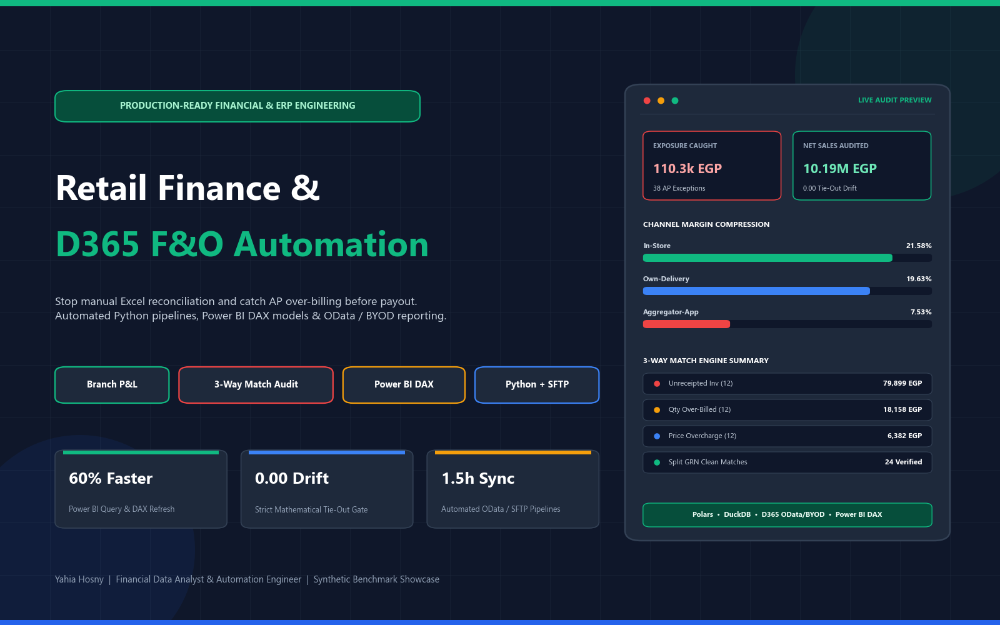

# Yahia Hosny — Retail Finance, 3-Way Match & D365 F&O Automation Portfolio

**Live Interactive Showcase:** https://yahia-hosny.github.io

> **100% Synthetic Retail Benchmark Dataset** — Zero confidential employer or client records are included in this repository. All core proprietary automation engines remain inside private repositories.

---

## Live Portfolio Deliverables

- **Interactive Executive Dashboard:** Open https://yahia-hosny.github.io to filter multi-branch channel margins (`In-Store`, `Own-Delivery`, `Aggregator-App`), inspect `38` Three-Way Match AP exceptions (`110,315.01 EGP` exposure), and review automated control tie-out governance (`0.00` drift).
- **Excel Deliverable 1 (Branch & Delivery P&L):** [`downloads/Portfolio_1_Retail_Branch_Delivery_PnL_Dashboard.xlsx`](downloads/Portfolio_1_Retail_Branch_Delivery_PnL_Dashboard.xlsx)
- **Excel Deliverable 2 (3-Way Match Audit):** [`downloads/Portfolio_2_Three_Way_Match_PO_GRN_Invoice_Audit.xlsx`](downloads/Portfolio_2_Three_Way_Match_PO_GRN_Invoice_Audit.xlsx)
- **Audit Governance JSON:** [`downloads/audit_verification_report.json`](downloads/audit_verification_report.json)

---

## Visual Architecture & Audit Benchmarks

### 1. Multi-Branch & Delivery Channel P&L (`10.19M EGP` Net Sales | `1.84M EGP` Contribution Profit)

### 2. Three-Way Match Audit Engine (`110,315.01 EGP` Exposure Caught | `24` Clean Split Matches)

### 3. D365 F&O (OData / BYOD), MS Graph API & SFTP Sync Architecture

---

## Connect & Discuss Your Pipeline

- **LinkedIn:** https://www.linkedin.com/in/yahia-hosny
- **Scope:** Microsoft Dynamics 365 F&O (`OData`, `BYOD`, `SQL`), Retail Finance & P&L Automation, Automated Excel & Power BI (`DAX`), Python ETL & API/SFTP Sync.
