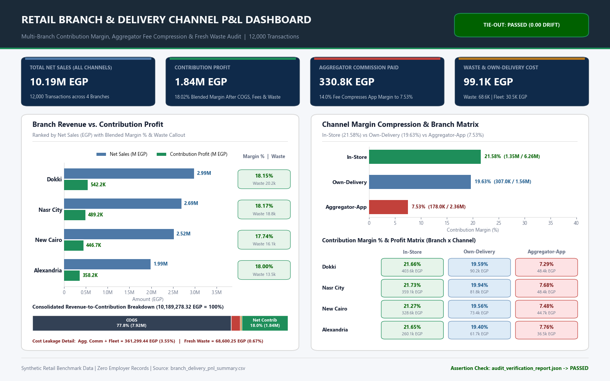
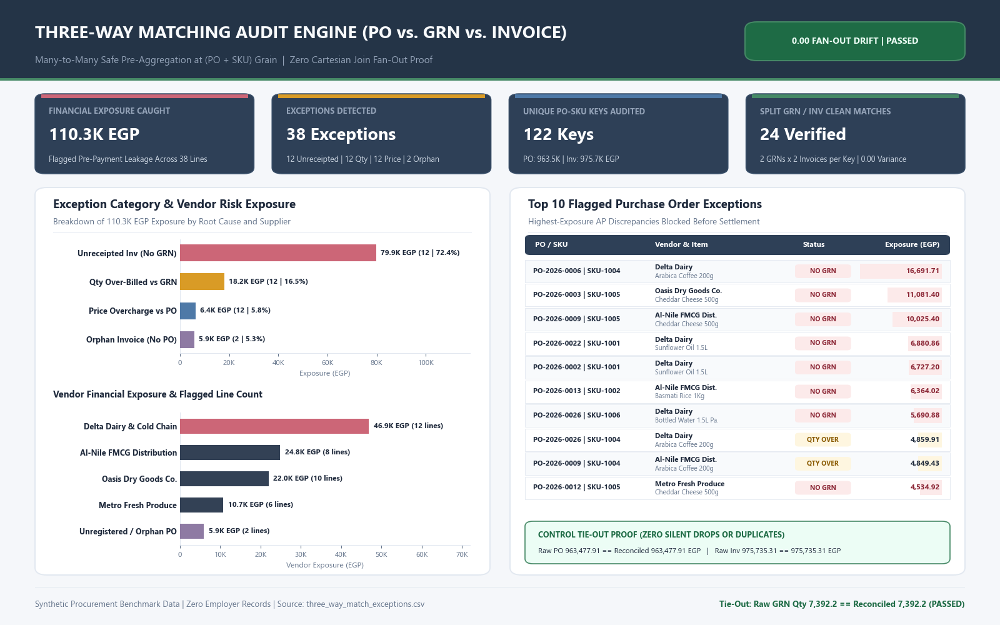
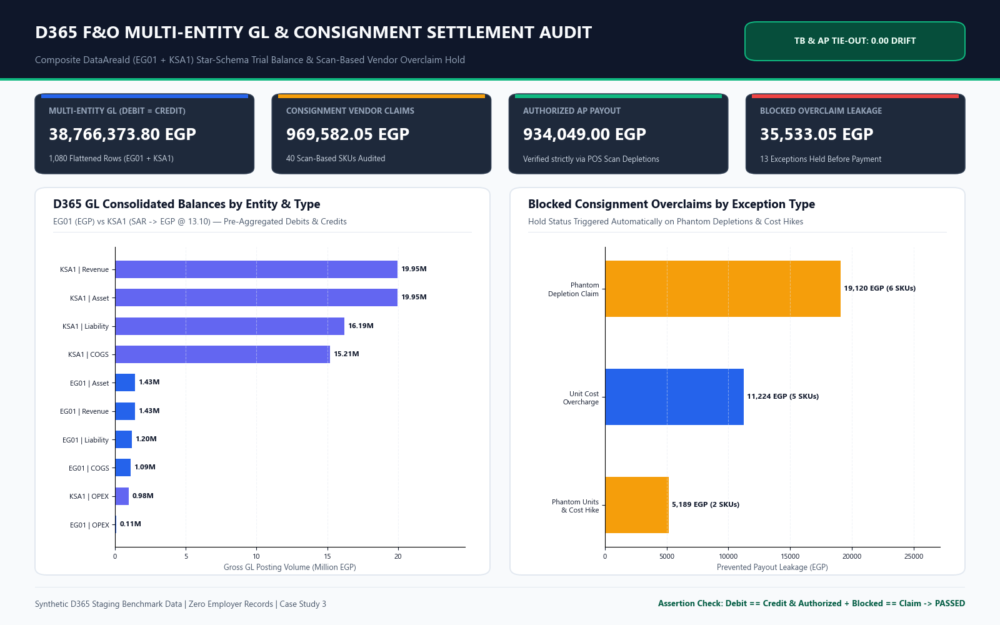
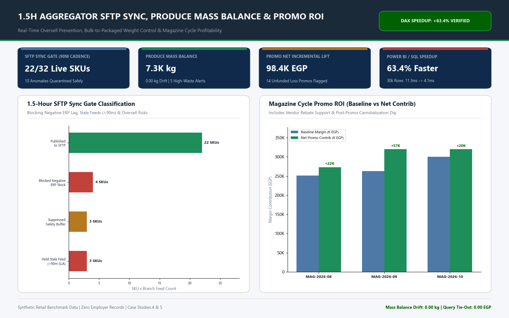
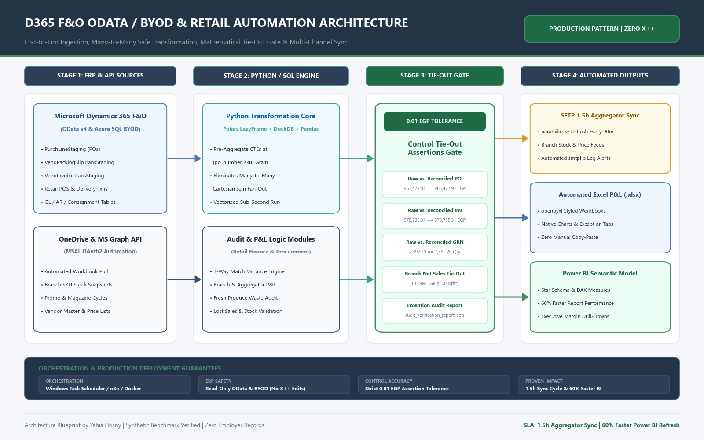

# Yahia Hosny — Retail Finance, 3-Way Match & D365 F&O Automation Portfolio (6 Case Studies)

**Live Interactive Showcase:** https://yahia-hosny.github.io

> **100% Synthetic Retail & ERP Benchmark Datasets** — Zero confidential employer or client records are included in this repository. All proprietary Python/SQL automation engines remain inside private repositories.

---

## Live 6-Case-Study Portfolio & Downloadable Deliverables

- **Interactive Executive Portal:** Open https://yahia-hosny.github.io to explore live filters, mathematical tie-out governance (`0.00` drift across all 6 modules), visual architecture charts, and downloadable Excel executive workbooks.
- **Case Study 1 — Multi-Branch & Delivery Channel P&L:** [`downloads/Portfolio_1_Retail_Branch_Delivery_PnL_Dashboard.xlsx`](downloads/Portfolio_1_Retail_Branch_Delivery_PnL_Dashboard.xlsx) (`10.19M EGP` Net Sales | `1.84M EGP` Contribution Profit)
- **Case Study 2 — Three-Way Match Audit (`PO vs GRN vs Invoice`):** [`downloads/Portfolio_2_Three_Way_Match_PO_GRN_Invoice_Audit.xlsx`](downloads/Portfolio_2_Three_Way_Match_PO_GRN_Invoice_Audit.xlsx) (`110.32K EGP` exposure caught across `38` exceptions | `24` clean split-GRN matches)
- **Case Study 3 — D365 F&O Multi-Entity GL (`EG01 + KSA1`) & Consignment Settlement:** [`downloads/Portfolio_3_D365_GL_TrialBalance_&_Consignment_Settlement.xlsx`](downloads/Portfolio_3_D365_GL_TrialBalance_&_Consignment_Settlement.xlsx) (`38.77M EGP` balanced GL | `35.53K EGP` blocked phantom consignment overclaims)
- **Case Study 4 — 1.5-Hour Aggregator SFTP Stock Gate & Produce Mass Balance:** [`downloads/Portfolio_4_Aggregator_Inventory_Sync_&_Produce_Control.xlsx`](downloads/Portfolio_4_Aggregator_Inventory_Sync_&_Produce_Control.xlsx) (`10` anomalies quarantined | `7.3K kg` produce mass balance at `0.00 kg` drift)
- **Case Study 5 — Magazine Cycle Promo ROI & Power BI Star-Schema Benchmark:** [`downloads/Portfolio_5_Promo_Cycle_ROI_&_PowerBI_StarSchema.xlsx`](downloads/Portfolio_5_Promo_Cycle_ROI_&_PowerBI_StarSchema.xlsx) (`14` loss-making promos caught | `71.72%` query speedup benchmark verified at `0.00` drift)
- **Case Study 6 — 11-Branch Delivery Channel P&L Executive Model (6-Sheet Styled Workbook):** [`downloads/Portfolio_6_Delivery_Channel_PnL_11Branches.xlsx`](downloads/Portfolio_6_Delivery_Channel_PnL_11Branches.xlsx) (`8.01M EGP` Net Sales across `19.66K` orders | `307.13K EGP` Net Profit | `2.8K+` verified live Excel formulas, `4` charts, DataBars & ColorScales, `0.00` drift)
- **Master Audit Verification Ledger:** [`downloads/audit_verification_report.json`](downloads/audit_verification_report.json)

---

## Executive Visual Gallery (6 Architecture & Audit Snapshots)

### 1. Multi-Branch & Delivery Channel P&L (`10.19M EGP` Net Sales | `1.84M EGP` Contribution Profit)

### 2. Three-Way Match Audit Engine (`110.32K EGP` Exposure Caught | `24` Clean Split Matches)

### 3. D365 F&O Multi-Entity Trial Balance & Consignment Audit (`35.53K EGP` Overclaims Blocked)

### 4. 1.5h Aggregator SFTP Sync, Produce Mass Balance & Magazine Promo ROI (`71.7%` Query Speedup)

### 5. D365 F&O (OData / BYOD), MS Graph API & SFTP Sync Architecture

---

## Connect & Discuss Your Pipeline

- **WhatsApp Business (Fastest Response — Daily from 9:00 PM Cairo / 10:00 PM KSA):** https://wa.me/201055520554 (`+20 105 552 0554` / `01055520554`)
- **Work Email:** yahiahosny58@gmail.com
- **LinkedIn:** https://www.linkedin.com/in/yahia-hosny
- **First-2-Clients Fast-Close Pilot Offer:** `75–120 USD` (`3.75K–6K EGP`) for a 3–4 day verified diagnostic & automation pilot (`100%` mathematical tie-out guaranteed; no confidential data required upfront).
- **Core Capabilities:** Microsoft Dynamics 365 F&O (`OData`, `BYOD`, `SQL`), Retail Finance & P&L Automation, Automated Excel & Power BI (`DAX`), Python ETL & API/SFTP Sync.
